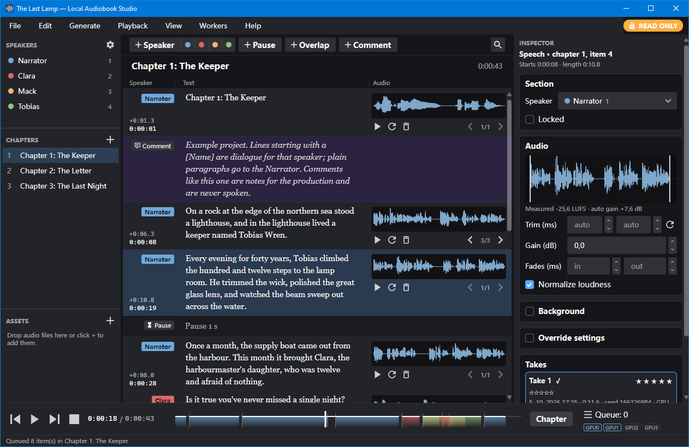
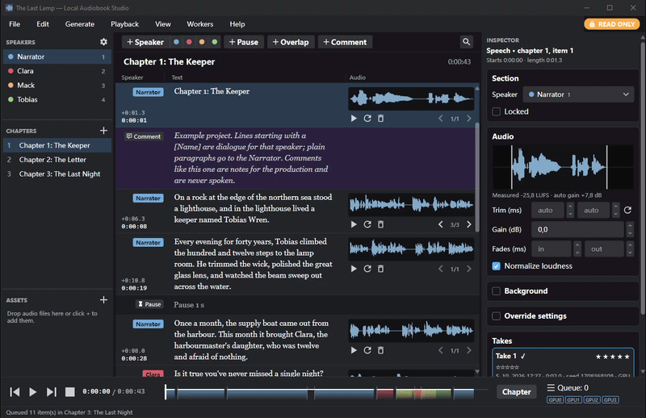
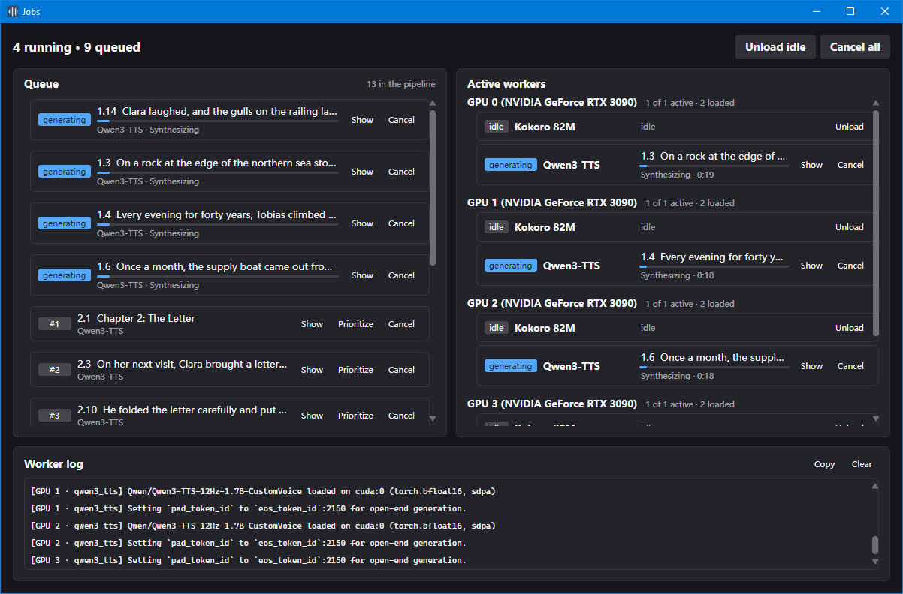
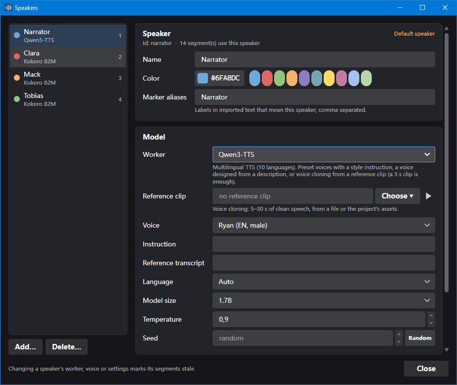
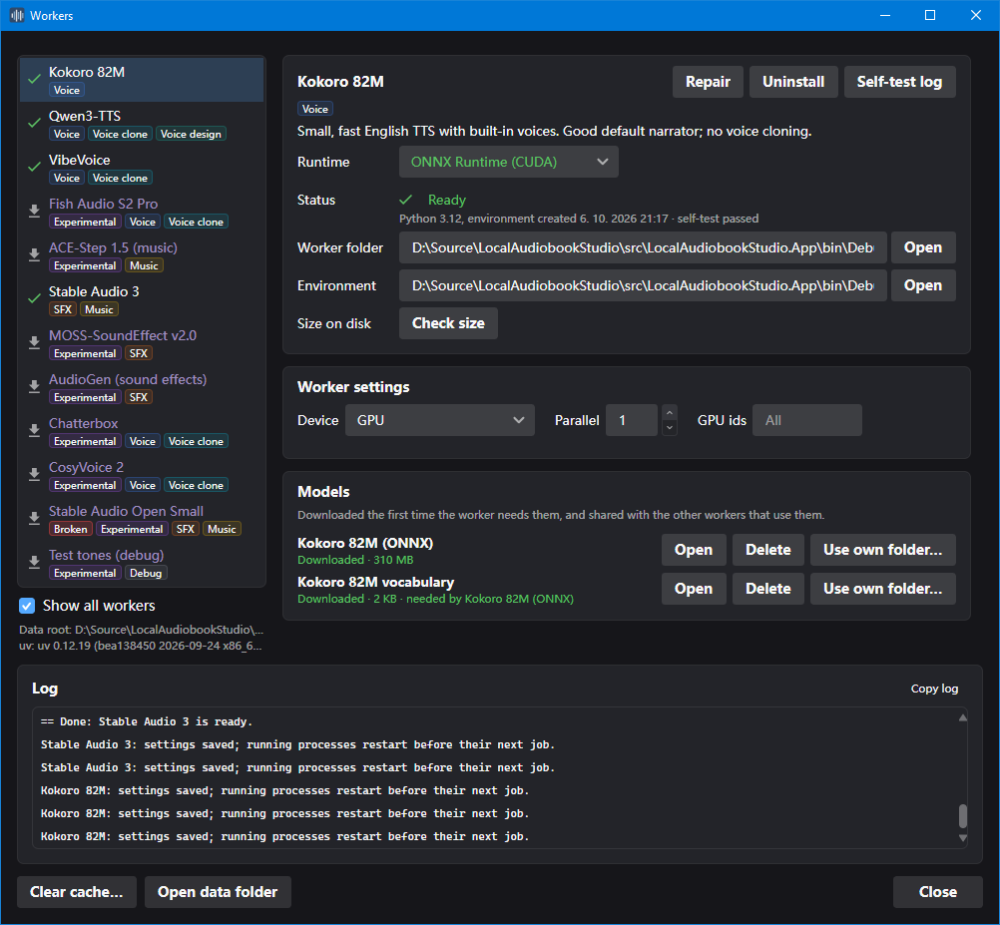

Turn books into audiobooks with AI voices that run on your own machine. Import a text, give each character a voice, generate, listen, fix what you don't like, and export an audiobook (M4B with chapters, or MP3). No cloud service, no account, no fees.



## Features

- **Easy to set up**: no command line use required. The application brings in all the components it needs.
- **Edit every paragraph on its own**: each paragraph is a row you can edit, regenerate, re-take, trim or reorder, and hear right away. Only what changed needs generating again.
- **Multiple speakers**: give each character their own voice, from built-in voices, a voice described in words, a clone of a short reference clip, or your own recording with a microphone.
- **Sound effects and background ambience**: generate effects and music from a description, and let them play underneath the speech.
- **Live scrubbing**: quickly move the play head through the take, chapter or entire book.
- **Everything runs locally**: the app installs its own Python and models. No cloud service, no account, and no other tools to set up.
- **Native desktop app**: written in C# with Avalonia. No browser UI and no local web server. Looks and works like any other desktop app.
- **Windows and Linux**: fully cross platform
- **Multi-GPU**: make use of all your NVIDIA GPUs for faster generation.
- **Your own ComfyUI workflows**: generate with any [ComfyUI](https://github.com/comfyanonymous/ComfyUI) workflow that ends in audio, on this machine or other ones. Tag its nodes and they become speaker settings (see [ComfyUI bridge](docs/comfyui.md)).
- **CPU-only inference**: no NVIDIA GPU needed (usably fast for smaller models).
- **Audiobook export**: M4B with chapter markers, MP3 or WAV at an even loudness.
- **Compact projects**: takes are stored as Opus, 6 to 10 times smaller than WAV. Imported MP3 files are kept as they are.
- **Command line**: `las` generates speech and runs whole projects (import → generate → export) for automation in your own scripts.
- **Portable, no install needed**: unzip and run. Settings, runtimes and models stay in your folder.

## Requirements

- **Windows 10/11 x64** or **Linux x64** (glibc 2.28 or newer, ALSA for audio).
- **NVIDIA GPU (optional but recommended)**: compute capability 7.5 or newer (Turing aka RTX 20xx series and up)
- **[.NET 10 Runtime](https://dotnet.microsoft.com/download/dotnet/10.0)**: Usually auto downloads, on Linux use the package manager (e.g. `sudo apt install dotnet-runtime-10.0`).
- **[ffmpeg](https://ffmpeg.org/download.html)**: for export/import. If missing, the system check downloads it (Windows) or shows the install command (Linux).
- **[uv](https://docs.astral.sh/uv/)**: for installing Python and pip packages. Included in the release zips; if missing (e.g. when built from source), the system check downloads it.
- **Disk space**: about 500MB for the app and Kokoro, may grow to >30GB with many models

## Supported runtimes

AI inference is done by workers, each running in its own process on one of these runtimes:

- **PyTorch** (Python): PyTorch 2.11 for NVIDIA GPUs (CUDA 12.8, driver 570+) installed with the bundled [uv](https://github.com/astral-sh/uv). (most widely supported but is huge at ~5GB per environment)
- **ONNX Runtime** (Python): [ONNX Runtime](https://onnxruntime.ai/) 1.30 on CPU or NVIDIA (CUDA 13, driver 580+). Smaller leaner alternative to Torch (~2GB per environment or ~350MB for CPU only)
- **HartsyInference** (.NET): Native C# inference using [HartsyInference](https://github.com/HartsyAI/HartsyInference), no Python at all. Fast and very lean (only 65MB), but still pretty new.
- **External**: the ComfyUI bridge runs your own [ComfyUI](https://github.com/comfyanonymous/ComfyUI) workflows on ComfyUI servers, on this machine or others. See [ComfyUI bridge](docs/comfyui.md)

## Screenshots

<table>
<tr>
<td width="50%"></td>
<td width="50%"></td>
</tr>
<tr>
<td align="center">Scrubbing through</td>
<td align="center">Job queues</td>
</tr>
<tr>
<td width="50%"></td>
<td width="50%"></td>
</tr>
<tr>
<td align="center">Speakers</td>
<td align="center">Workers</td>
</tr>
</table>

## Getting started

1. **Download** the latest release from the [Releases](../../releases) page. Or [build it from source](#building-from-source).
2. **Unzip** it into a folder of your choice. There is no installer: the folder is the app.
3. **Start** `LocalAudiobookStudio.exe` (on Linux: `./LocalAudiobookStudio`). Windows may show a SmartScreen warning the first time, because the release isn't code-signed: choose *More info → Run anyway*.
4. **Welcome screen**: choose where to keep settings, Python and models (in the app folder, for a portable setup, or in your user profile). The system check shows what your machine has and fixes what's missing, such as ffmpeg. Leave *Install the Kokoro worker* and *Open the example project* ticked, then press *Continue*.
5. **The first voice**: the Workers window opens and installs Kokoro, a small, fast English voice that also runs on the CPU. It runs on HartsyInference, which comes with the app, so there is no Python to install; the model (330 MB) downloads the first time you generate. Later you may want to install larger, more capable models from the same window.
6. **Try it out**: with *Open the example project* ticked, an example project opens, ready to generate with Kokoro. Press **G** to generate a chapter (Ctrl+Shift+G for the whole book) and Space to listen. Otherwise, start with *File → New project* in an empty folder, then *File → Import text* (Ctrl+I) a `.txt` file. From there, give characters their own voices in *View → Speakers*, fix lines and regenerate them with **R**, and export with *File → Export audiobook* (Ctrl+E).

## Writing the text

Plain text works as-is: blank lines separate paragraphs and headings start chapters. Markers like `[Alice] Hello.`, `[pause 1.5s]` and `[comment: …]` add speakers, pauses and notes; sound effects are lines for a speaker whose worker makes sounds (`[Sounds] distant thunder`). See the [text format](docs/text-format.md) for all of them.

## Workers (voices and sound models)

A worker is a model the app runs in its own process, on one of the [supported runtimes](#supported-runtimes). Speech, voice cloning, sound effects and music are covered; see [supported models](docs/models.md) for the full list with links and licenses. **The app's MIT license does not cover the models:** some don't allow commercial use.

For models the app doesn't include, the [ComfyUI bridge](docs/comfyui.md) runs your own ComfyUI workflows as a worker.

## Projects

A project is a folder (new ones are named `<title>.audiobook`):

```text
MyBook.audiobook/
  local_audiobook_studio.json  app marker, title, author, defaults
  chapters/                    one JSON file per chapter (the segments)
  speakers/                    speaker settings and reference clips
  audio/                       generated and recorded takes per segment (Opus, or WAV)
  assets/                      imported audio files and ComfyUI workflows, in folders if you like
  export/                      exported audiobooks
  .cache/                      rebuildable caches (not packed)
```

New takes, recordings and imported WAV files are stored as Opus; *Project properties* sets the Opus quality (48, 64 or 96 kbps per channel) or switches a project to WAV, and *File → Compress takes to Opus* converts existing WAV takes. MP3 and Opus files you import are kept as they are; other formats are converted with ffmpeg.

*File → Pack project* creates a single `.abproj` file (a zip) for backup or sharing; *File → Unpack project* opens one.

## Command line

`las` is installed next to the app and uses the app's settings, installed workers and devices.

```bash
# One-off text to speech (like the preview button; no project involved)
las tts "Hello there." -o hello.wav
echo "Piped text" | las tts -o out.wav --voice am_michael
las tts -i chapters/ -o audio/ --skip-existing          # a folder of .txt files, one WAV each

# A whole pipeline on a project: steps run in order and stop at the first failure
las project MyBook import book.txt erase-takes generate export -o book.m4b

# Change a voice, then regenerate only what became stale
las project MyBook speaker narrator --voice bf_emma generate

# Information
las workers            # installed workers; 'las workers kokoro' shows settings and voices
las models             # downloaded models and their size on disk
las doctor             # system check
las --json project MyBook status
```

Run `las help`, `las help tts` or `las help project` for all options. Exit codes: 0 ok, 1 something failed, 2 wrong usage, 3 setup needed, 130 cancelled. A project can't be open in the app and in `las` at the same time.

## Troubleshooting

- *Help → System check* (or `las doctor`) checks the GPU, driver, uv, HartsyInference, ffmpeg, audio devices and disk space.
- A worker that shows as *Broken* in the Workers window can be repaired from there.
- The log folder has a log per session (`session-*.log`, and `cli-*.log` for `las`).
- When reporting an issue, please include the output of *Help → About → Copy info* and *Help → System check → Copy report*.

## Building from source
Requires the [.NET 10 SDK](https://dotnet.microsoft.com/download), Python not needed.

#### Quickest:

Run `run.bat` (Windows, double-click) or `./run.sh` (Linux) in the repository root: they run `dotnet run` for the app.

#### IDE:

Open `LocalAudiobookStudio.sln` in Visual Studio (or Rider) and press **Build** or **Run**. That's all, the app is the startup project.

#### CLI:

```bash
git clone https://github.com/Berni-k/LocalAudiobookStudio.git
cd LocalAudiobookStudio
dotnet run --project src/LocalAudiobookStudio.App
```

The build puts the app into `src/LocalAudiobookStudio.App/bin/<Configuration>/net10.0/`. It also includes `las` (the command line), the `workers` folder and the HartsyInference worker (`hartsy/`). uv is only included if you fetched it with `tools/uv/fetch-uv.ps1` (or `.sh`); otherwise the system check downloads it.

Run the tests with `dotnet test`; they need no GPU, workers or network.

### Repository layout

| Folder | Contents |
|---|---|
| `src/LocalAudiobookStudio.App` | The desktop app (Avalonia): views, view models, playback and recording |
| `src/LocalAudiobookStudio.Cli` | `las`, the command line |
| `src/LocalAudiobookStudio.Engine` | Everything without a UI: host, project engine, export, one-off generation, system checks |
| `src/LocalAudiobookStudio.Core` | Project model, text import, timeline, settings |
| `src/LocalAudiobookStudio.Audio` | Decoding, mixing, loudness and peaks |
| `src/LocalAudiobookStudio.Workers` | Worker processes, protocol, scheduler, Python environments |
| `src/LocalAudiobookStudio.HartsyWorker` | The HartsyInference worker (`las-hartsy-worker`) |
| `workers/` | Worker manifests and Python workers; `environments.json` defines the shared environments, `models.json` pins every model's files |
| `tools/uv` | The pinned uv version and scripts to fetch it (not in the repository; release builds bundle it) |
| `tests/` | Unit tests |
| `docs/` | User documentation: [text format](docs/text-format.md), [supported models](docs/models.md), [ComfyUI bridge](docs/comfyui.md) |
| `examples/` | The example project, copied next to the app |

## License

Local Audiobook Studio is released under the [MIT License](LICENSE.txt). Copyright (c) 2026 Berni.

It builds on [Avalonia](https://avaloniaui.net/), [Semi.Avalonia](https://github.com/irihitech/Semi.Avalonia), [NAudio](https://github.com/naudio/NAudio), [Concentus](https://github.com/lostromb/concentus), [NLayer](https://github.com/naudio/NLayer), [CommunityToolkit.Mvvm](https://github.com/CommunityToolkit/dotnet), [HartsyInference](https://github.com/HartsyAI/HartsyInference) and [uv](https://github.com/astral-sh/uv); their licenses are in [THIRD-PARTY-NOTICES.md](THIRD-PARTY-NOTICES.md). The AI models are separate downloads under their own licenses (see [supported models](docs/models.md)).
